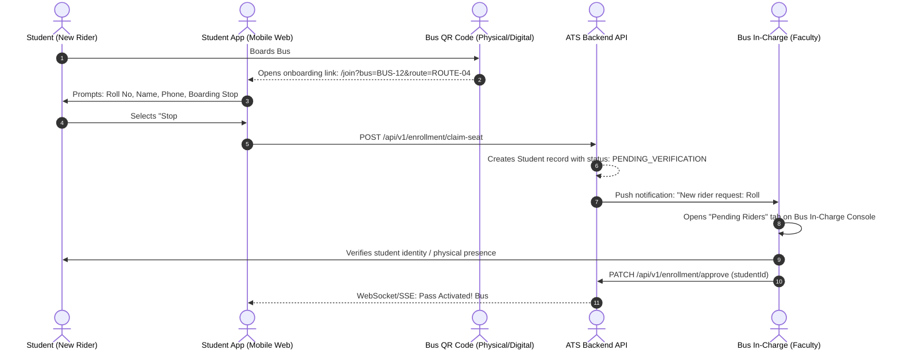

# 08. Version 2: Role Duties, Interaction Matrix & Decentralized Enrollment Plan

## 1. Executive Summary

In a college transit ecosystem managing **60–100 buses** and **3,000–5,000 students**, centralizing enrollment through a single administrator or SPOC (Single Point of Contact) creates a severe operational bottleneck. Furthermore, mixing administrative student handling with driving operations poses significant safety hazards.

This document defines the **Version 2 Architecture** for:
1. **Separation of Concerns:** Strict isolation between vehicle navigation (Driver), crowd/safety coordination and pass verification (Bus In-Charge), commuter awareness (Student), and fleet dispatch (Admin).
2. **Decentralized In-Bus Enrollment (Tier 3 - Channel C):** Eliminates SPOC overhead by delegating student registration and onboarding directly to the 60+ Bus In-Charges in parallel via in-vehicle QR codes.
3. **In-Charge Physical Fee Verification (Tier 4):** Removes dependencies on college finance/accounts software by enabling Bus In-Charges to directly inspect payment receipts and mark student bus pass renewals.

---

## 2. Role Duties & Interaction Topology

```
┌────────────────────────────────────────────────────────────────────────────────────────┐
│                               ROLE INTERACTION TOPOLOGY                                │
├─────────────────┬──────────────────────┬───────────────────────────────────────────────┤
│ ROLE            │ PRIMARY RESPONSIBILITY│ DAY-TO-DAY INTERACTIONS                      │
├─────────────────┼──────────────────────┼───────────────────────────────────────────────┤
│ 1. Super Admin  │ Fleet Oversight,     │ • Configures routes, stops, and vehicles     │
│    (Transport   │ Master Data &        │ • Monitors live control tower & adherence    │
│     Cell)       │ Emergency Dispatch   │ • Authorizes emergency relief diversions      │
│                 │                      │ • Reviews cross-fleet route load heatmaps     │
├─────────────────┼──────────────────────┼───────────────────────────────────────────────┤
│ 2. Driver       │ Safe Driving &       │ • Authenticates via Phone + PIN              │
│    (Captain /   │ Telemetry Streaming  │ • 100% hands-free during active driving       │
│     Delegated)  │                      │ • Background daemon auto-streams GPS (3s)    │
│                 │                      │ • 1-Tap SOS with passenger count band        │
│                 │                      │ • Generates handover QR for relief drivers   │
├─────────────────┼──────────────────────┼───────────────────────────────────────────────┤
│ 3. Bus In-Charge│ Passenger Safety,    │ • Point-of-contact for student/parent calls  │
│    (Faculty /   │ Discipline & Bus     │ • Verifies and approves new student passes   │
│     Staff)      │ Pass Verification    │ • Inspects fee receipts and marks renewals   │
│                 │                      │ • Backup SOS dispatcher if driver phone dies │
│                 │                      │ • Confirms safe arrival and deboarding       │
├─────────────────┼──────────────────────┼───────────────────────────────────────────────┤
│ 4. Student      │ Commuter             │ • Scans in-bus QR to register on first trip  │
│    (Passenger)  │                      │ • Tracks assigned bus live location and ETA   │
│                 │                      │ • Contacts Bus In-Charge (driver contact is  │
│                 │                      │   hidden during driving to avoid distraction)│
│                 │                      │ • Shows fee receipt to In-Charge for renewal │
└─────────────────┴──────────────────────┴───────────────────────────────────────────────┘
```

---

## 3. Communication Boundary Rules

To ensure safety and minimize driver distraction:
1. **Driver Isolation in Transit:** Students and parents **never** see the active driver's phone number while the bus is in transit (`ShiftStatus.ON_DUTY`). Instead, the student app displays the **Bus In-Charge's name and contact number**.
2. **Single Primary SOS Initiator with In-Charge Fallback:**
   - The driver triggers SOS via a single dashboard button.
   - If the driver's phone loses battery, crashes, or is out of network, the Bus In-Charge console has secondary authorization to declare an emergency incident for that bus.
3. **Delegation Awareness:** If the assigned captain delegates duty to a relief driver, the student app dynamically updates the vehicle profile to display the substitute's details alongside the permanent Bus In-Charge.

---

## 4. Decentralized 4-Tier Enrollment Architecture

```
           ┌────────────────────────────────────────────────────────┐
           │          TIER 1: MASTER DATA SETUP (ADMIN)             │
           │  Annual setup: Buses, Routes, Geofenced Stops, Timetable│
           └───────────────────────────┬────────────────────────────┘
                                       │
           ┌───────────────────────────┴────────────────────────────┐
           │        TIER 2: DRIVER & IN-CHARGE INITIALIZATION       │
           │  Transport Cell registers ~150 staff & drivers         │
           │  • Drivers: Mobile Number + 4-digit PIN                │
           │  • In-Charges: College Email SSO / Phone Auth          │
           └───────────────────────────┬────────────────────────────┘
                                       │
           ┌───────────────────────────┴────────────────────────────┐
           │    TIER 3: DECENTRALIZED IN-BUS ONBOARDING (CHANNEL C) │
           │  • Physical/Digital QR posted in each bus              │
           │  • Student scans QR on morning commute & inputs details│
           │  • In-Charge approves riders face-to-face in app       │
           │  => 60 In-Charges onboard 3,000 students in parallel!  │
           └───────────────────────────┬────────────────────────────┘
                                       │
           ┌───────────────────────────┴────────────────────────────┐
           │       TIER 4: IN-PERSON RENEWALS & CAPACITY AUDIT      │
           │  • Student presents payment receipt to Bus In-Charge   │
           │  • In-Charge marks renewal status in console           │
           │  • End-of-year automatic graduation archival           │
           │  • Stop capacity balancing heatmap                     │
           └────────────────────────────────────────────────────────┘
```

---

### Tier 1: Master Fleet & Route Configuration (Admin Setup)
- Executed by the Transport Manager prior to the academic semester:
  - **Vehicles:** Bus Number, License Plate, Seating Capacity (e.g. 50 seats).
  - **Routes & Stops:** Ordered sequence of stops with GPS latitude/longitude, stop name, and scheduled arrival target.
  - Generates the base registry in PostgreSQL via Prisma.

---

### Tier 2: Driver & In-Charge Roster Setup
- A simple, low-friction setup for the institutional staff:
  - **Drivers (~80–100 accounts):** Transport Office inputs Driver Name, Mobile Number, and Default Assigned Bus. Drivers log in with **Mobile Number + 4-digit PIN** (no complicated passwords).
  - **Bus In-Charges (~60–80 faculty):** Enrolled with Name, Department, Mobile Number, and Assigned Bus. Authentication is via **College Google/Microsoft SSO** or Mobile OTP.

---

### Tier 3: In-Bus QR Onboarding Workflow (Channel C)

This channel eliminates the central SPOC bottleneck during semester orientation:



#### Key Advantages of Channel C:
1. **Parallel Execution:** Instead of 1 admin processing 3,000 records, **60 In-Charges verify ~40–50 students each** during their routine morning commute.
2. **Ground Reality Check:** The In-Charge verifies that the student is actually standing inside that bus and that their stop is on the route.
3. **Zero Administrative Backlog:** Students have working live tracking within their very first ride.

---

### Tier 4: Lifecycle, In-Person Renewal & Capacity Management

#### 1. In-Charge Physical Fee Verification & Renewal
Rather than integrating with complex, siloed college accounting software:
1. The student pays their annual/semester transport fee via the college bank challan, cashier counter, or online payment receipt.
2. The student presents the physical/digital receipt to their **Bus In-Charge** during the morning commute.
3. The In-Charge opens their **Bus In-Charge Console**, selects the student from their roster, and taps **"Verify & Renew Pass"**:
   - Optional: Inputs Receipt / Challan Number.
   - Sets the pass validity for the active semester/year.
   - Status updates from `RENEWAL_DUE` to `ACTIVE`.
4. If a student has not renewed after a grace period (e.g., 14 days), the In-Charge console flags them in amber, allowing the In-Charge to follow up in person.

#### 2. Year-End Graduating Batch Archival
- Each student record contains their graduation year (e.g. `Batch: 2026`).
- At the end of the academic year (e.g. June 30), the system runs an automated rollover job:
  - Archives all passing-out final year students (`status = ARCHIVED`).
  - Releases their seat allocation from the bus capacity pool.
  - Retains travel and incident audit logs for historical compliance.

#### 3. Stop Capacity Balancing & Route Heatmaps
- The Admin Control Tower visualizes a live stop load matrix:
  - *Example:* Stop #3 on Route #8 has 65 active students registered, but Bus #8 has a 52-seat capacity.
  - The system highlights Route #8 in red and suggests splitting the stop with nearby Route #11 before overcrowding causes roadside delays.

---

## 5. Version 2 Database Schema Extensions

To support the V2 decentralized model, the following schema additions will be introduced:

```prisma
// Pass Status Lifecycle
enum PassStatus {
  PENDING_VERIFICATION
  ACTIVE
  RENEWAL_DUE
  SUSPENDED
  ARCHIVED
}

model StudentProfile {
  id              String      @id @default(uuid())
  userId          String      @unique
  rollNumber      String      @unique
  batchYear       Int         // e.g., 2026
  department      String      // e.g., "CSE"
  boardingStopId  String
  assignedBusId   String
  assignedRouteId String
  passStatus      PassStatus  @default(PENDING_VERIFICATION)
  receiptNumber   String?
  verifiedById    String?     // In-Charge User ID who approved
  verifiedAt      DateTime?
  validUntil      DateTime?
  
  user            User        @relation(fields: [userId], references: [id])
  boardingStop    Stop        @relation(fields: [boardingStopId], references: [id])
  assignedBus     Bus         @relation(fields: [assignedBusId], references: [id])
  assignedRoute   Route       @relation(fields: [assignedRouteId], references: [id])
  verifiedBy      User?       @relation("VerifiedPasses", fields: [verifiedById], references: [id])

  createdAt       DateTime    @default(now())
  updatedAt       DateTime    @updatedAt

  @@index([rollNumber])
  @@index([assignedBusId, passStatus])
}
```

---

## 6. Version 2 API Endpoint Design

| Method | Endpoint | Authorized Roles | Description |
| :--- | :--- | :--- | :--- |
| `POST` | `/api/v1/enrollment/claim-bus` | Public / Student | Student scans bus QR code and registers for bus and stop |
| `GET` | `/api/v1/enrollment/incharge/roster` | `BUS_INCHARGE` | Retrieves pending and active students for the In-Charge's assigned bus |
| `PATCH` | `/api/v1/enrollment/incharge/approve` | `BUS_INCHARGE` | In-Charge approves a pending student onboarding request |
| `PATCH` | `/api/v1/enrollment/incharge/renew` | `BUS_INCHARGE` | In-Charge enters receipt number and marks student pass as renewed |
| `GET` | `/api/v1/analytics/stop-capacity-heatmap` | `SUPER_ADMIN` | Compares student registrations per stop against bus capacities |
| `POST` | `/api/v1/admin/rollover/archive-batch` | `SUPER_ADMIN` | Archives graduating batch students at the end of the academic year |
